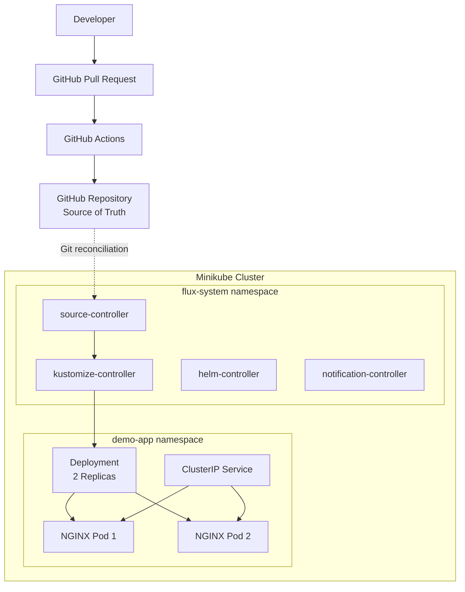
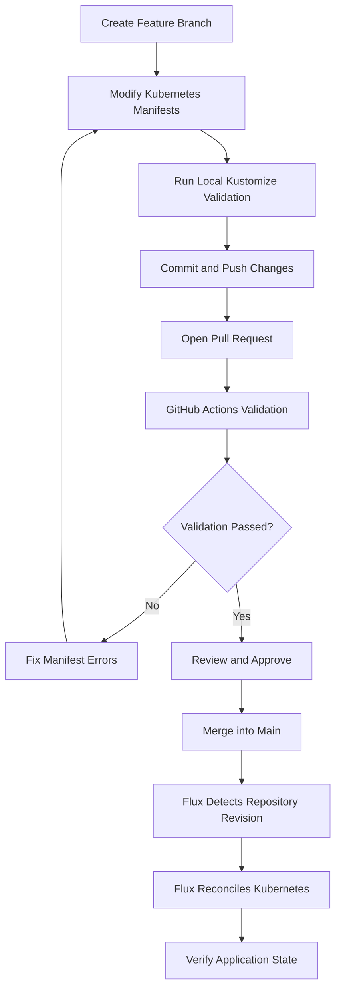
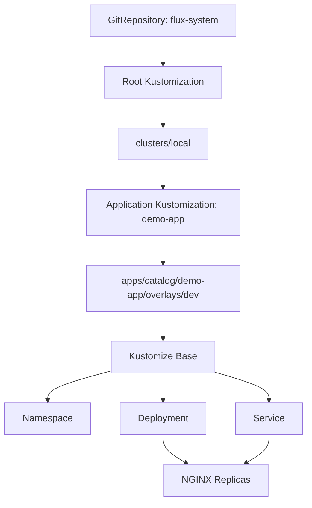

# GitOps Fleet Platform

A Kubernetes GitOps platform built with **Flux CD v2, Kustomize, GitHub Actions, and Minikube**.

This repository demonstrates a declarative approach to Kubernetes application delivery, where Git is the single source of truth for the desired cluster state and Flux continuously reconciles Kubernetes resources against the configuration stored in the repository.

The initial implementation focuses on a local Kubernetes environment using Minikube. The architecture is designed to evolve towards multi-application and multi-environment GitOps management.

---

## Table of Contents

- [Architecture Overview](#architecture-overview)
- [Technology Stack](#technology-stack)
- [Repository Structure](#repository-structure)
- [GitOps Operating Model](#gitops-operating-model)
- [Reconciliation Architecture](#reconciliation-architecture)
- [Bootstrap and Installation](#bootstrap-and-installation)
- [Application Deployment](#application-deployment)
- [Validation and Testing](#validation-and-testing)
- [Operational Commands](#operational-commands)
- [Security and Reliability](#security-and-reliability)
- [Current Implementation Status](#current-implementation-status)
- [Roadmap](#roadmap)

---

## Architecture Overview

The platform follows a pull-based GitOps architecture.

GitHub stores the desired Kubernetes state. Flux controllers running inside the Kubernetes cluster periodically retrieve the repository, build the Kustomize configurations, and reconcile the declared resources.

Minikube provides the local Kubernetes environment used to validate the platform.

### High-Level Architecture



### Core Design Principles

- Git as the single source of truth for Kubernetes desired state.
- Pull-based reconciliation through Flux CD.
- Declarative application deployment using Kubernetes manifests.
- Reusable configuration through Kustomize bases and overlays.
- Automated manifest validation through GitHub Actions.
- Clear separation between platform controllers and application workloads.
- Version-controlled changes and Git-based rollback procedures.

---

## Technology Stack

| Component | Purpose |
|---|---|
| Kubernetes | Container orchestration |
| Minikube | Local Kubernetes cluster |
| Flux CD v2 | GitOps reconciliation |
| source-controller | Git repository synchronization |
| kustomize-controller | Declarative resource reconciliation |
| helm-controller | Helm release management capability |
| notification-controller | Event and notification management capability |
| Kustomize | Kubernetes manifest composition |
| GitHub | Source code and desired state management |
| GitHub Actions | CI manifest validation |
| NGINX Unprivileged | Demo application container |
| kubectl | Kubernetes administration |
| Flux CLI | Flux bootstrap and operational management |

---

## Repository Structure

```text
gitops-flux-fleet/
│
├── .github/
│   └── workflows/
│       └── validate-gitops.yaml
│
├── apps/
│   ├── kustomization.yaml
│   └── catalog/
│       └── demo-app/
│           ├── base/
│           │   ├── deployment.yaml
│           │   ├── namespace.yaml
│           │   ├── service.yaml
│           │   └── kustomization.yaml
│           │
│           └── overlays/
│               └── dev/
│                   └── kustomization.yaml
│
├── clusters/
│   └── local/
│       ├── kustomization.yaml
│       ├── apps.yaml
│       │
│       └── flux-system/
│           ├── gotk-components.yaml
│           ├── gotk-sync.yaml
│           └── kustomization.yaml
│
├── .gitignore
└── README.md
```

### Directory Responsibilities

**`.github/workflows/`**

Contains GitHub Actions workflows used to validate Kubernetes manifests before changes are integrated into the main branch.

**`apps/catalog/`**

Contains application definitions organized by application, with reusable base manifests and environment-specific overlays.

**`clusters/local/`**

Defines the desired state of the local Kubernetes cluster and its Flux reconciliation resources.

**`clusters/local/flux-system/`**

Contains the Flux installation manifests and Git synchronization configuration generated during bootstrap.

---

## GitOps Operating Model

The platform uses a Git-driven workflow.

### Standard Development Workflow



### Branching Strategy

The initial development workflow uses:

- `main`: stable and integrated platform configuration.
- `feat/*`: feature development and infrastructure changes.
- Pull Requests: controlled integration into `main`.

Changes to Kubernetes desired state must be committed to Git.

Manual modifications using `kubectl` are intended for troubleshooting and inspection, not as the permanent configuration mechanism.

---

## Reconciliation Architecture

Flux manages two primary Kustomizations in the local cluster.

### Root Kustomization

Resource:

`clusters/local/flux-system/gotk-sync.yaml`

The root Flux Kustomization references:

```yaml
spec:
  interval: 10m0s
  path: ./clusters/local
  prune: true
  sourceRef:
    kind: GitRepository
    name: flux-system
```

Its responsibilities are:

- Retrieve the Git repository revision.
- Build the configuration under `clusters/local`.
- Apply the cluster-level GitOps configuration.
- Maintain the declared cluster resources.

### Application Kustomization

Resource:

`clusters/local/apps.yaml`

```yaml
apiVersion: kustomize.toolkit.fluxcd.io/v1
kind: Kustomization
metadata:
  name: demo-app
  namespace: flux-system
spec:
  interval: 5m
  path: ./apps/catalog/demo-app/overlays/dev
  prune: true
  sourceRef:
    kind: GitRepository
    name: flux-system
  wait: true
  timeout: 2m
```

This resource defines an independent reconciliation process for the demo application.

Its responsibilities are:

- Build the application overlay.
- Apply the application resources.
- Wait for the declared resources to become ready.
- Remove resources no longer declared in the managed configuration when pruning applies.

### Reconciliation Settings

| Setting | Configuration | Purpose |
|---|---|---|
| Source interval | 1 minute | Check the Git source |
| Root reconciliation | 10 minutes | Reconcile cluster configuration |
| Application reconciliation | 5 minutes | Reconcile demo application |
| Prune | Enabled | Remove obsolete managed resources |
| Wait | Enabled for demo-app | Wait for resource readiness |
| Timeout | 2 minutes | Application reconciliation timeout |

Flux also supports event-driven reconciliation through supported notification integrations. The current implementation uses periodic reconciliation.

---

## Bootstrap and Installation

The initial environment uses Minikube.

### Prerequisites

Install and configure:

- Docker
- Minikube
- kubectl
- Flux CLI
- Git
- GitHub repository access

Verify the local cluster:

```bash
minikube status

kubectl config current-context

kubectl get nodes
```

The current Kubernetes context must point to `minikube`.

### Validate Flux Prerequisites

```bash
flux version

flux check --pre
```

### Bootstrap Flux

Create a GitHub Personal Access Token with the permissions required to configure repository access and deploy keys.

Export the token:

```bash
export GITHUB_TOKEN="YOUR_GITHUB_TOKEN"
```

Run the bootstrap command:

```bash
flux bootstrap github \
  --owner=dubercode \
  --repository=gitops-flux-fleet \
  --branch=feat/gitops-platform-foundation \
  --path=clusters/local \
  --personal \
  --token-auth=false
```

This operation:

1. Installs Flux controllers into the cluster.
2. Configures Git repository access using an SSH deploy key.
3. Creates or updates Flux synchronization manifests.
4. Configures the root reconciliation path.
5. Establishes the Git-to-Kubernetes reconciliation loop.

The bootstrap process should be performed against the intended cluster and repository branch.

### Verify Installation

```bash
kubectl get pods -n flux-system

flux get all -A
```

Expected controllers:

- source-controller
- kustomize-controller
- helm-controller
- notification-controller

---

## Application Deployment

The platform currently manages an NGINX unprivileged application.

### Application Definition

Location:

`apps/catalog/demo-app/`

The application consists of:

**Namespace**

`apps/catalog/demo-app/base/namespace.yaml`

Creates the isolated `demo-app` namespace.

**Deployment**

`apps/catalog/demo-app/base/deployment.yaml`

Defines the NGINX workload with:

- Two desired replicas.
- Unprivileged NGINX container image.
- Container port 8080.
- CPU and memory requests and limits.
- Readiness and liveness probes.
- Non-root execution.
- Restricted Linux capabilities.
- Disabled privilege escalation.
- RuntimeDefault seccomp profile.

**Service**

`apps/catalog/demo-app/base/service.yaml`

Defines a ClusterIP Service exposing port 80 and forwarding traffic to the named container port `http`.

### Kustomize Overlay

Location:

`apps/catalog/demo-app/overlays/dev/kustomization.yaml`

The development overlay references the reusable application base.

This structure allows future environments to reuse the same base configuration while introducing environment-specific differences.

### Application Deployment Flow



---

## Validation and Testing

Validation takes place at two levels: local development and GitHub Actions.

### Local Kustomize Validation

Validate the application:

```bash
kubectl kustomize apps/catalog/demo-app/overlays/dev
```

Validate the cluster configuration:

```bash
kubectl kustomize clusters/local
```

Check whitespace and patch errors:

```bash
git diff --check
```

### GitHub Actions Validation

Workflow:

`.github/workflows/validate-gitops.yaml`

The workflow runs on:

- Pull Requests targeting `main`.
- Pushes to `feat/gitops-platform-foundation`.

It validates:

```bash
kustomize build clusters/local

kustomize build apps/catalog/demo-app/overlays/dev
```

The workflow uses read-only repository permissions.

### Runtime Validation

Check Flux reconciliation:

```bash
flux get all -A
```

Check workloads:

```bash
kubectl get pods -A
```

Check application resources:

```bash
kubectl get deployment,svc -n demo-app
```

Check endpoint discovery:

```bash
kubectl get endpointslices -n demo-app
```

Check deployment details:

```bash
kubectl describe deployment web-app -n demo-app
```

### HTTP Connectivity Test

Start port forwarding:

```bash
kubectl port-forward \
  -n demo-app \
  svc/web-app-svc 8080:80
```

From another terminal:

```bash
curl -I http://localhost:8080
```

Expected response:

```text
HTTP/1.1 200 OK
Server: nginx
```

---

## Operational Commands

### Inspect Flux Resources

```bash
flux get sources git -A

flux get kustomizations -A

flux get all -A
```

### Force Source Reconciliation

```bash
flux reconcile source git flux-system \
  -n flux-system
```

### Force Application Reconciliation

```bash
flux reconcile kustomization demo-app \
  -n flux-system \
  --with-source
```

### Inspect Application Logs

```bash
kubectl logs \
  -n demo-app \
  deployment/web-app
```

### Scale the Application Through Git

Update the desired replica count in:

`apps/catalog/demo-app/base/deployment.yaml`

For example:

```yaml
spec:
  replicas: 2
```

Commit and push the change.

Flux will detect the new repository revision and reconcile the Deployment.

The desired state must be changed in Git rather than relying on a manual `kubectl scale` operation.

### Rollback Strategy

The Git-based rollback procedure is:

1. Identify the commit that introduced the unwanted configuration.
2. Revert that commit.
3. Push the revert to the repository.
4. Allow Flux to reconcile the previous desired state.
5. Verify the Kubernetes resources.

Example:

```bash
git revert <commit-sha>

git push origin <branch-name>
```

Rollback is performed through version-controlled desired state rather than manually editing live resources.

---

## Security and Reliability

The initial implementation incorporates several baseline security and reliability controls.

### Container Security

The NGINX workload uses:

- Non-root execution.
- Disabled privilege escalation.
- Dropped Linux capabilities.
- RuntimeDefault seccomp profile.
- CPU and memory resource requests and limits.
- Readiness and liveness probes.

### GitOps Security

- GitHub repository access through an SSH deploy key.
- GitHub Actions uses read-only repository permissions for validation.
- Desired Kubernetes state is version controlled.
- Changes are integrated through Pull Requests.

### Reconciliation Reliability

- Flux periodically checks the Git source.
- Kustomize reconciliation is declarative.
- Pruning removes obsolete managed resources.
- Application reconciliation waits for readiness.
- Git history provides an auditable change trail.

The current implementation is a local development and demonstration platform. Additional controls are required before production adoption, including stronger supply-chain security, image digest pinning, policy enforcement, secret encryption, controller resource sizing, and access-control hardening.

---

## Current Implementation Status

The following capabilities have been implemented and validated in the local Minikube environment.

| Capability | Status |
|---|---|
| Minikube Kubernetes environment | Implemented |
| Flux CD bootstrap | Implemented |
| GitRepository synchronization | Validated |
| Root Flux Kustomization | Validated |
| Application Kustomization | Validated |
| Kustomize base and dev overlay | Implemented |
| NGINX unprivileged Deployment | Validated |
| ClusterIP Service | Validated |
| Two available application replicas | Validated |
| Service endpoint discovery | Validated |
| GitHub Actions manifest validation workflow | Implemented |
| HTTP connectivity test | Pending final verification |
| Multi-application management | Planned |
| Multi-environment promotion | Planned |
| Automated security policy enforcement | Planned |

---

## Roadmap

The platform will evolve through incremental implementation phases.

### Phase 1 — GitOps Platform Foundation

- [x] Establish repository structure.
- [x] Configure Minikube.
- [x] Bootstrap Flux CD.
- [x] Configure Git synchronization.
- [x] Deploy the initial application.
- [x] Configure Kustomize base and overlay.
- [x] Implement GitHub Actions manifest validation.
- [x] Validate Flux reconciliation.
- [x] Validate two available application replicas.
- [ ] Complete HTTP connectivity verification.
- [ ] Merge the foundation into `main`.

### Phase 2 — Multi-Application GitOps

- [ ] Introduce a second independent application.
- [ ] Organize application catalogs.
- [ ] Define independent Flux Kustomizations.
- [ ] Establish application ownership boundaries.
- [ ] Validate independent application reconciliation.

### Phase 3 — Environment Management

- [ ] Introduce staging and production overlays.
- [ ] Implement controlled environment promotion.
- [ ] Define environment-specific configuration.
- [ ] Establish deployment approval gates.

### Phase 4 — Security and Supply Chain

- [ ] Integrate image scanning.
- [ ] Implement image digest pinning.
- [ ] Introduce policy-as-code.
- [ ] Integrate SOPS for encrypted secrets.
- [ ] Strengthen CI security controls.
- [ ] Implement admission policies.

### Phase 5 — Observability and Operations

- [ ] Integrate Prometheus and Grafana.
- [ ] Configure Flux metrics monitoring.
- [ ] Implement alerting.
- [ ] Define application health indicators.
- [ ] Document incident response and recovery procedures.

### Phase 6 — Production-Ready Platform Evolution

- [ ] Define production-grade access controls.
- [ ] Implement multi-cluster management.
- [ ] Establish disaster recovery procedures.
- [ ] Define operational SLOs and SLIs.
- [ ] Document platform lifecycle management.

---

## Project Objective

This repository is an evolving hands-on implementation of Kubernetes GitOps and Platform Engineering practices.

The goal is to demonstrate how infrastructure and application delivery can be managed through declarative configuration, automated validation, continuous reconciliation, controlled change management, and secure operational practices.

**Git is the source of truth. Flux is the reconciliation engine. Kubernetes is the execution platform.**